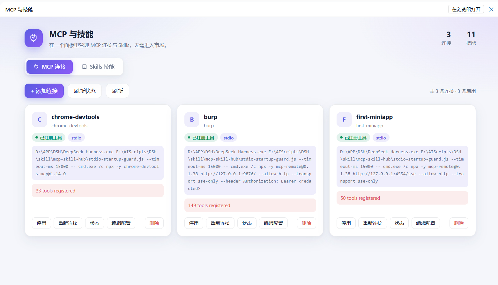
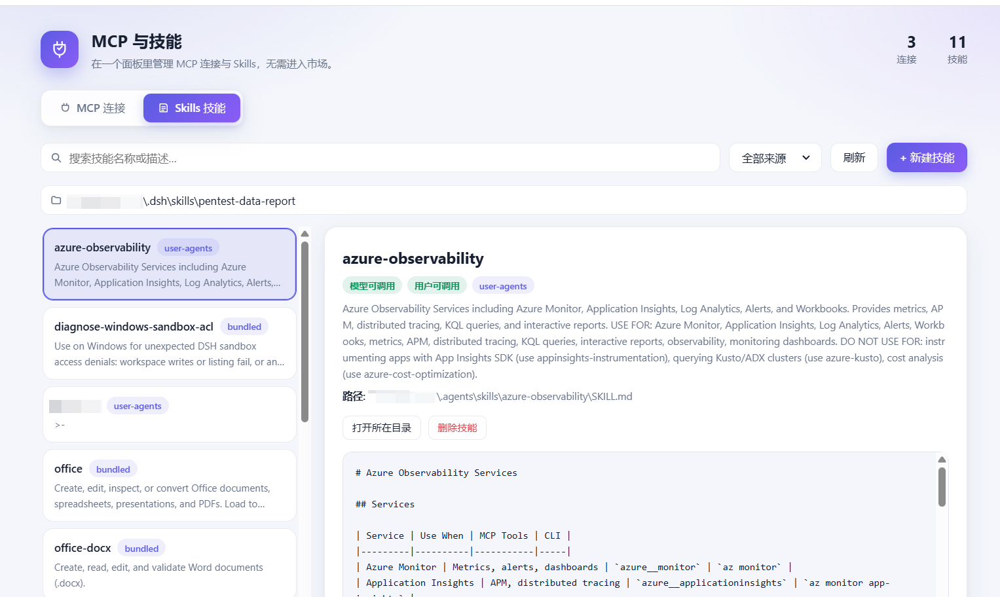

# dsh-mcp-skill-hub

在 DeepSeek Harness 侧边栏里统一管理 **MCP 连接** 和 **Agent 技能**的一个插件。
One sidebar panel for **MCP connections** and **Agent skills** in DeepSeek Harness.

> 不依赖 `dsh-mcp-connector`：MCP 管理直接走 DSH 核心的 `@deepseek-ai/dsh-mcp-client`，连接器可以停用。
> No dependency on `dsh-mcp-connector` — MCP management talks to the core `@deepseek-ai/dsh-mcp-client` directly, so the connector can stay disabled.

## 界面截图 / Screenshots

**MCP 连接 / MCP connections** — 每条连接的状态、已注册工具数，以及启用 / 重连 / 编辑配置操作：



**Skills 技能 / Skills** — 技能列表、来源标签（`bundled` / `user-agents` / `user-dsh`）与 `SKILL.md` 内容预览：



## 功能 / Features

**MCP 标签页**
- 连接状态卡片：`connected` / `pending` / `disabled` / 报错原因一眼可见，带工具数量
- 启用、停用、重连、健康检查
- 查看并就地编辑 JSON 配置（改完立即生效）
- 删除连接、从 JSON 导入新连接
- 状态接口对 `Authorization: Bearer …` 等敏感参数做脱敏

**Skills 标签页**
- 汇总用户级 `~/.dsh/skills`、`~/.agents/skills`，可选项目级 `.dsh/skills`、`.agents/skills`
- 搜索、按来源过滤、查看完整 `SKILL.md` 内容
- 新建技能、删除技能、在文件管理器中定位技能目录
- 内置来源（bundled）与用户技能分别标注

## 安装 / Install

DSH 插件管理里添加本仓库即可（推荐固定版本或 commit，便于回滚）：

```jsonc
// 已是 DSH profile 的 dependencies 时
"dsh-mcp-skill-hub": "github:youyouiooi/dsh-mcp-skill-hub"
```

或按 commit / tag 锁定：

```jsonc
"dsh-mcp-skill-hub": "github:youyouiooi/dsh-mcp-skill-hub#v1.0.0"
```

不想从源码安装时，直接用 [Releases](https://github.com/youyouiooi/dsh-mcp-skill-hub/releases) 里的预构建包
`dsh-mcp-skill-hub-1.0.0.tgz`（插件管理 → 安装本地 bundle / 压缩包）。

本地开发：把插件目录 `link:` 进 profile，或直接用插件管理的「安装本地 bundle」指向该目录。

安装并启用后，侧边栏会出现插头图标（排在 MCP 连接器下方），点开即是面板。

## 结构 / Layout

| 文件 | 作用 |
| --- | --- |
| `index.js` | Host 半端：经 `webServer` 注册 `/mcp-skill-hub/` 路由，提供页面与 `api/skills*`、`api/mcp` |
| `mcp-backend.js` | 独立 MCP 后端：`status / healthCheck / setEnabled / reconnect / disconnect / importJson / editableConnectionConfig / reconfigureConnection / migrate`，变更走串行队列 |
| `stdio-startup-guard.js` | stdio 启动看门狗：统一用 `process.execPath` 拉起，Windows 上把 `npx/npm/pnpm` 交给 `cmd.exe`，握手超时或启动即退出时给出可诊断错误并回收子进程 |
| `client.js` | Client 半端：注册 `main` 面板（key `dsh-mcp-skill-hub`）与 `sidebar.panellist` 入口 |
| `ui/index.html` | 面板页面，中英双语、明暗主题自适应 |
| `locale/*.json` | 插件名称与描述的本地化文案 |

## 关键行为 / Behavior notes

- 连接条目就是 DSH loader 里的 `@deepseek-ai/dsh-mcp-client` 行，插件不复制条目，因此不会重复注册工具。
- `serverName` 决定工具名前缀 `mcp__<serverName>__<tool>`，编辑配置时不可改名（改名等于换一套工具）。
- 只有 `editableConnectionConfig` 返回真实配置，`status` 一律脱敏。
- 所有 stdio 连接统一经过内置看门狗；首次启动会把旧的 Connector 看门狗参数自动替换掉。
- 核心包没有健康检查 API，因此“健康”以**实际注册的工具数**为唯一诚实信号，不假装探活。

## 排错 / Troubleshooting

**`pending` 且 0 tools**：多半是 stdio 起不来。Windows 上已知问题——本机 npm 10.9.8 下
`npx -y <pkg>@latest` 会报 `'<pkg>' is not recognized as an internal or external command`，
而固定版本正常。把版本从 `@latest` 改成固定版本再重连，例如：

```
npx -y chrome-devtools-mcp@1.14.0
```

**面板 404**：确认插件 entry 处于 `active`；路由前缀不带尾部斜杠（`/mcp-skill-hub`）。

**改了代码没生效**：停用再启用该插件会重新加载 JS；若是替换了已安装包，重启 DSH 更稳。

## 兼容性 / Compatibility

在 DSH `0.2.2-rc.1`（Windows，Electron 宿主）上开发与验证：

- chrome-devtools（stdio + npx）33 tools
- burp（stdio + mcp-remote SSE）149 tools
- first-miniapp（stdio + mcp-remote SSE）50 tools

以上均在 `dsh-mcp-connector` **停用**状态下实测可用。

## 许可 / License

[MIT](./LICENSE)
